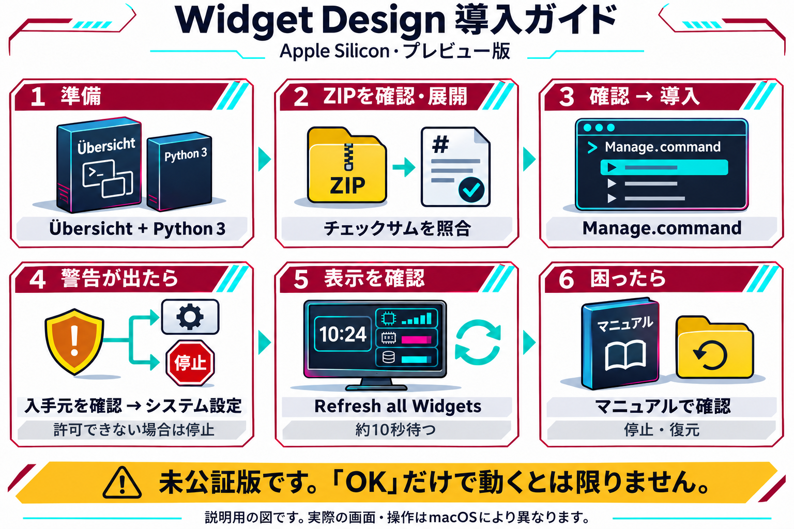

# Widget Design 導入手順 — Apple Siliconプレビュー版

[English](INSTALL.md) | **日本語**

パッケージ版: `0.1.0-preview.1`。[Apple Silicon向けのプレリリース](https://github.com/panna-elec/widget-design-original-cp/releases/tag/v0.1.0-preview.1)です。Apple公証済みの正式版ではありません。arm64版の実行ファイルと完全な対応ソースを同梱します。まずこの手順と`Manage.command`を使用してください。既存の日本語の開始・停止ショートカットは任意のSketchyBar構成用で、今回の導入には不要です。


**GitHubのソースZIPと配布ZIPは別です。** GitHubの**Code → Download ZIP**にはコンパイル済みの`stats`、`MANIFEST.json`、`BUILD-INFO.json`は含まれません。実行ファイル入りのApple Silicon版ZIPとチェックサムは、[v0.1.0-preview.1プレリリース](https://github.com/panna-elec/widget-design-original-cp/releases/tag/v0.1.0-preview.1)から取得できます。ソースから取得した場合はビルド手順を使用し、`Manage.command`はビルド済みの配布パッケージから実行してください。

**START-HERE.html**をダブルクリックすると、オフラインで読めるマニュアルがブラウザーで開きます。サーバー・アカウント・専用の文書アプリは不要です。日本語またはEnglishを選び、紙やPDFにする場合はブラウザーの「プリント」を使います。画像とリンクを保つため、展開フォルダを一式保持してください。

[図解を原寸で開く](docs/manual/quickstart-ja.png)



*AIで生成した説明用の図で、実際の画面のスクリーンショットではありません。操作の詳細は以下の文章を参照してください。図は互換性やセキュリティ承認を保証するものではありません。*

## 必要なもの

- Apple Silicon Macでネイティブ実行（Rosettaを使用しない）。バイナリのビルド対象はmacOS 13以降。実測確認はmacOS 26.6.1で、旧OSは未検証です。
- [Übersicht公式版](https://tracesof.net/uebersicht/)を別途導入。検証版は1.6、build 82。アプリ本体は同梱しません。
- Python 3.10以上。確認版は3.13.18。必要なら[python.org](https://www.python.org/downloads/macos/)から導入するか、既存のHomebrew版を利用します。pipライブラリは不要です。依存ソフトの導入時には管理者認証を求められる場合があります。
- 通常のZIP導入にNode.js、npm、Swift、SketchyBar、管理者権限は不要です。ソースから再ビルドする場合のみXcode Command Line Toolsが必要です。

Pythonは`/opt/homebrew/bin/python3`→`/usr/local/bin/python3`→PATH上の絶対パスの順で検出します。開発ツールの導入画面が出る可能性があるシステムのPythonスタブは使用しません。特殊な配置では環境変数`CYBERDECK_PYTHON`に実行ファイルの絶対パスを指定できますが、Übersichtにも同じ変数が渡る必要があります。Terminalだけに設定してもGUIアプリには反映されません。

## 確認と導入

1. ZIPと対応する`.zip.sha256`を同じフォルダに置き、Terminalでそのフォルダへ移動して確認します。

   ```sh
   shasum -a 256 -c widget-design-0.1.0-preview.1-macos-arm64.zip.sha256
   ```

   `OK`ならチェックサム一致です。配布元が信頼できることまで証明するものではありません。
2. ZIPを展開し、フォルダの中身を一式保持します。実行ファイルだけを取り出さないでください。
3. Übersichtを導入・起動し、メニューの**Open Widgets Folder**で配置先を確認します。標準は`~/Library/Application Support/Übersicht/widgets/`です。
4. `Manage.command`をダブルクリックして**1 — 確認のみ**を選びます。Terminalで展開フォルダへ移動して、次を実行しても同じです。

   ```sh
   bash Manage.command check
   ```

   Terminalで対象フォルダへ移動するには、`cd `（末尾に半角スペース）を入力し、Finderから展開フォルダをTerminalへドラッグしてReturnを押します。その後、コマンドを1つずつ貼り付けます。画面のプロンプト記号は入力しません。

   依存環境と`MANIFEST.json`に記録された全配布ファイルを確認します。配置・実測値の取得・デスクトップ設定変更はしません。不足する依存ソフトを勝手にインストールすることもありません。
5. **2 — 新規導入**を選ぶか、`bash Manage.command install`を実行します。同名の`cyberdeck.widget`があれば上書きせず停止します。標準以外の配置先では次を使用します。

   ```sh
   bash Manage.command install --widgets-dir "/path/to/widgets"
   ```

   更新・停止・復元時も同じ`--widgets-dir`を指定してください。Übersicht自体の場所が特殊なら`--uebersicht-app "/path/to/Übersicht.app"`も指定できます。シンボリックリンク経由の場所は拒否します。バックアップはウィジェットや配布フォルダの外で、同じファイルシステム上に置きます。必要なら`--backup-dir "/path/to/backups"`を指定し、以後も同じ場所を指定します。
6. Übersichtの**Refresh all Widgets**を実行し、2回の計測が揃う約10秒を待ちます。カレンダーとデスクを開き、表示言語を選びます。ウィジェットの操作前後でデスクトップのファイルも選択できることを確認します。
7. 必要ならシステム設定の壁紙に`wallpaper-reference.png`を選びます。他のPNGはCYBER・CLEAN用です。インストーラーは壁紙・ログイン項目・他のウィジェットを変更しません。

## macOSのセキュリティ表示

Appleの公証はセキュリティ検査であり、著作権ライセンスやGitHubでソース・試用ZIPを公開するための一律の許可証ではありません。未公証の試用版を配布する場合は起動時の制約を明記します。一方、現在のソフトウェアをDeveloper ID署名付きで配布する経路ではAppleは公証を要求しています。今回の候補にDeveloper ID署名はありません。[Appleの公証の説明](https://developer.apple.com/documentation/security/notarizing-macos-software-before-distribution)を参照してください。

今回の実行ファイルは**アドホック署名のみ**で、**Developer ID署名・Apple公証はありません**。ローカルの署名検証成功はGatekeeperの承認とは異なります。ブラウザーからダウンロードした場合はブロックされる可能性があります。入手元とソースを確認し、ブロックされた場合は[Apple公式の案内](https://support.apple.com/ja-jp/102445)に従ってください。Gatekeeperの無効化や隔離属性の一括削除は行わないでください。適切な個別承認が表示されない場合は停止し、確認したソースからのローカルビルドか、署名済み配布版を利用します。`Manage.command`の承認だけで`stats`も承認されるとは限りません。

通常の導入でアクセシビリティ・画面収録・フルディスクアクセスを一律に要求しません。エラー解消だけのために無関係な権限を付与しないでください。リンクから開くフォルダに対するアクセス権限はOSの管理に従います。「鑑賞モード」は明示操作でFinderのアイコン表示を変更して再読み込みする機能なので、Finderでファイルを処理している間は使用を避けてください。

## 警告が出たときの順序

**「OK」を押せば追加できますか？** 必ずしもそうではありません。ウィジェットの配置と計測用`stats`の実行許可は別で、`Manage.command`への許可だけで両方が済むとは限りません。別のMacで実際にダウンロードした場合の承認手順は未検証です。

1. 警告に表示された対象名を読みます。`Manage.command`は導入メニュー、`stats`は`cyberdeck.widget/bin/`に入っている計測用のプログラムです。似た名前という理由だけで別のファイルを許可しないでください。
2. 入手元とチェックサムを確認します。チェックサム不一致、想定外のファイル、「コンピュータに損害を与える」等の表示がある場合は、許可を進めず停止します。
3. 入手元と内容を信頼でき、通常の「開発元を確認できない」「検証できない」という警告の場合は、[Appleの公式手順](https://support.apple.com/ja-jp/102445)を参照します。一度起動を試した後、**システム設定 → プライバシーとセキュリティ**に、その対象の**このまま開く**が表示される場合があります。対象名を確認し、そのソフトを信頼して実行する意思がある場合だけ個別に許可します。認証を求められた場合はmacOSの画面に従います。表記はOSによって変わります。
4. 適切な個別許可が出ない、または組織管理のMacで許可できない場合は停止し、管理者に確認するか署名・公証済みの配布を待ってください。Gatekeeperの無効化、隔離属性の一括削除、フルディスクアクセスの付与で回避しないでください。
5. 許可できたら失敗した操作をやり直し、**Refresh all Widgets**を実行します。パネルだけ表示されて計測値が出ない場合は、`stats`が別途ブロックされている可能性があります。インストーラーを何度も押しても、その許可が済むとは限りません。

## 困ったとき

| 症状・表示 | 確認すること |
| --- | --- |
| `Python 3.10+ not found` | Python公式のmacOSインストーラーで導入するか、既存のHomebrew版を確認し、`bash Manage.command check`を再実行します。標準配置ならÜbersichtとTerminalのPATHが違っても検出します。 |
| `Install Übersicht first` | アプリがApplicationsまたはユーザーのApplicationsにあるか確認します。別の場所なら前述の`--uebersicht-app`を指定します。ツールはアプリを勝手にダウンロードしません。 |
| `Already installed` | 既存のCyberdeckを入れ替える意思がある場合だけ「更新」を使い、表示されるバックアップIDを控えます。この表示の解消のために個人データを消す必要はありません。 |
| `Package checksum mismatch` / `Package files changed` | 確認済みのZIPを新しいフォルダへ展開し直します。`MANIFEST.json`を書き換えて検証を回避しないでください。 |
| 何も表示されない | ÜbersichtのOpen Widgets Folderで実際の配置先を確認し、直下に`cyberdeck.widget`があるか確認してRefreshします。配布フォルダ全体をさらに1階層挟んで配置しないでください。 |
| パネルは出るが計測値が出ない | まず約10秒待ちます。続く場合はPythonと`stats`への警告を確認します。旧macOSでの実機動作は未確認です。 |
| ボタンやファイルのクリックができない | Refreshし、同じウィジェットの旧コピーが監視フォルダ内で重複していないか確認します。続く場合は停止またはバックアップ復元を使います。無関係なセキュリティ設定は変更しません。このZIPでのネイティブ画面の直接操作は再検証していません。 |
| 更新・復元中に`Stopped`が出た | エラーを読み、バックアップを保持します。最後の配置に失敗した場合は元の版へ戻す処理が入っています。復旧中にバックアップや記録を手動で削除しないでください。 |
| ファイルのアイコンが隠れたまま | 表示中なら鑑賞モードの「元の表示へ戻す」を使います。「停止」も所有する復元記録を使って戻そうとし、失敗時はウィジェットを残します。`desktop-mode.json`は元の表示設定の記録なので削除しないでください。 |
| 以前の見た目に戻したい | 初期テーマ設定はバックアップ復元で戻します。鯉の大きさ・線幅はデスク→演出連動で100%を選びます。ウィジェットの復元ではタスクやその後保存したデスク設定は巻き戻りません。 |

問い合わせる場合は、配布版番号、macOS、Übersichtの版・build、Pythonの版、操作とエラーを伝えてください。ログやスクリーンショットから個人名・ホームフォルダのパス・タスク・リンク・無関係なファイルを除き、Cyberdeckの個人状態フォルダやバックアップをそのまま添付しないでください。

## 更新・停止・復元

保守操作の前に操作パネルを閉じてください。途中の再読み込みを避けるならÜbersichtを一時終了し、完了後に再起動・Refreshします。その間は他のウィジェットも止まります。インストーラーはアプリを強制終了しません。

新しく展開した未変更の配布フォルダから実行します。

```sh
bash Manage.command update
bash Manage.command disable
bash Manage.command restore --backup-id 表示されたバックアップID
```

- **更新:** 既存版を個別バックアップへ退避して新しい版を配置します。`lib/preferences.json`を保持し、最後の配置に失敗すれば以前の版へ戻します。
- **停止:** このウィジェットが保存した鑑賞モードの記録がある場合だけアイコン表示を復元し、`cyberdeck.widget`を退避します。復元に失敗した場合は導入済みフォルダを残します。壁紙は変更しません。
- **復元:** 指定したバックアップとその初期デザイン設定を戻します。現在の版があれば先にバックアップします。個人のタスクや、その後保存したデスク設定まで古い状態へ戻す処理ではありません。

バックアップは`~/Library/Application Support/Cyberdeck-install-backups/`に保存されます。Übersichtが監視するフォルダの外なので、旧版が重複起動しません。表示されたIDを控えてください。バックアップは自動削除しません。個人用設定を含む可能性があるためアップロードしないでください。

タスク・リンク・配置・鯉設定は`~/Library/Application Support/Cyberdeck/`に残ります。導入・更新は`state.json`を読まず、上書き・削除しません。停止時だけ必要に応じて鑑賞モードの復元記録を使用します。ZIPに個人状態は同梱しません。導入後のフォルダ名`cyberdeck.widget`は変更しないでください。

## 同梱ソースからビルド

ソース、テスト、ライセンス原文、ビルド・導入スクリプトはZIP内にリポジトリと同じ構成で含まれています。非公開URLや追加のソース請求は不要です。`BUILD-INFO.json`に基点コミット・未コミット変更を含む各ソースのSHA-256・コンパイラ・ターゲット・実行ファイルのSHAを記録します。`MANIFEST.json`は配布ファイルを網羅します。基点コミットだけで今回のローカル変更を再現できるという意味ではありません。

Xcode Command Line Toolsを導入して、展開フォルダから次を実行します。

```sh
WIDGET_SOURCE_COMMIT="$(python3 -c "import json; print(json.load(open('BUILD-INFO.json'))['sourceBaseCommit'])")"
python3 scripts/build-distribution.py --version 0.1.0-preview.1 --source-base "$WIDGET_SOURCE_COMMIT" --output ./exports-rebuilt
```

明示リスト`distribution/files.json`だけを梱包し、`native/Stats.swift`を`arm64-apple-macos13.0`向けにコンパイル・アドホック署名してZIPとSHA-256を作ります。アップロード・インストール・既存成果物の上書きはしません。コンパイラやSDKによってバイナリは変わり、異なるツールチェーン間のバイト一致は保証しません。

実行ファイル単体のソースビルドは次です（配布マニフェストを検証する更新経路とは別）。

```sh
swiftc -O -target arm64-apple-macos13.0 native/Stats.swift -o cyberdeck.widget/bin/stats
bash scripts/install-widget.sh
```

既存のソース用インストーラーは初回導入のみで、既存版は上書きしません。配布物を編集するとマニフェスト不一致になるため、編集後に`Manage.command`を使うには新しいZIPをビルドしてください。任意のソース用機能は[SETUP.md](SETUP.md)、GPL・CC BY・第三者例外は[LICENSE_SCOPE.md](LICENSE_SCOPE.md)を参照してください。

## 検証の範囲

実際の結果は[distribution/VALIDATION.md](distribution/VALIDATION.md)に記録しています。ローカルでのZIP展開試験は、別のMacでの新規導入やブラウザーダウンロードの隔離属性を伴う試験とは異なります。一般配布前には別のApple Silicon Macでの導入と、Developer ID署名・公証の扱いを確認してください。Intel版、実機の接続方式切替、複数画面・スリープ復帰の網羅検証は今回の対象外です。
