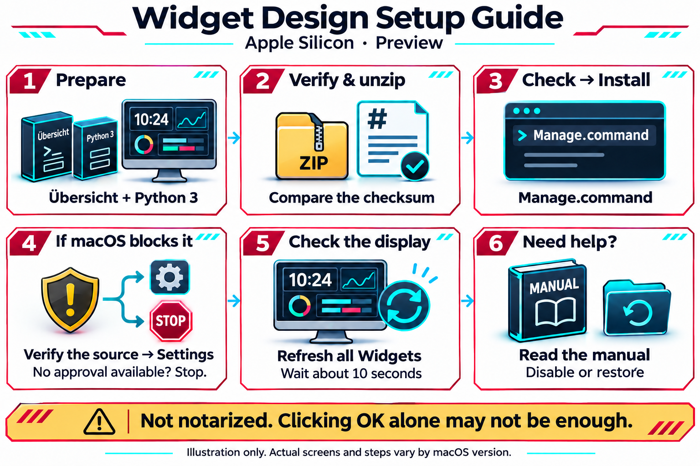

# Install Widget Design — Apple Silicon preview

**English** | [日本語](INSTALL.ja.md)

Package: `0.1.0-preview.1`. This is the [Apple Silicon prerelease](https://github.com/panna-elec/widget-design-original-cp/releases/tag/v0.1.0-preview.1), not a notarized production release. It contains the compiled arm64 collector and its complete corresponding source. Start with this guide and `Manage.command`; the Japanese legacy start/stop shortcuts are for the optional SketchyBar setup and are not needed here.


**GitHub source ZIP vs. distribution ZIP:** GitHub’s **Code → Download ZIP** contains source only; it does not include the compiled `stats`, `MANIFEST.json` or `BUILD-INFO.json`. The prebuilt Apple Silicon ZIP and its checksum are available from the [v0.1.0-preview.1 prerelease](https://github.com/panna-elec/widget-design-original-cp/releases/tag/v0.1.0-preview.1). For a source checkout, use the source-build instructions below; use `Manage.command` only from a built distribution package.

Open **START-HERE.html** in your browser for the offline manual. No server, account or extra reader is needed. Choose English or 日本語; use your browser's Print command for a paper/PDF copy. Keep the entire extracted folder together so its illustrations and links work.

[View the illustration at full size](docs/manual/quickstart-en.png)



*AI-generated explanatory illustration, not a screenshot. Read the exact steps below; the image does not establish compatibility or security approval.*

## Requirements

- Apple Silicon Mac, running natively (not Rosetta). Binary deployment target: macOS 13+. Tested on macOS 26.6.1; earlier versions are not yet verified.
- [Übersicht](https://tracesof.net/uebersicht/) installed separately. Tested with version 1.6, build 82. The app is not bundled.
- Python 3.10+ with the standard library. Tested with 3.13.18. Install from [python.org](https://www.python.org/downloads/macos/) or use an existing Homebrew Python. No pip packages required. Installing those prerequisites may request administrator authentication.
- No Node.js, Swift compiler, npm packages, SketchyBar or administrator privileges are needed for normal ZIP installation. Rebuilding the binary needs Xcode Command Line Tools.

The widget looks for Python at `/opt/homebrew/bin/python3`, then `/usr/local/bin/python3`, then an absolute `python3` found in PATH. It avoids the system Python stub that could trigger a developer-tools installer. For a nonstandard installation, `CYBERDECK_PYTHON` can select an absolute executable, but Übersicht must inherit the same variable; a Terminal-only setting does not configure the GUI app.

## Verify and install

1. Keep the ZIP and matching `.zip.sha256` side by side. In Terminal, change to their folder and run:

   ```sh
   shasum -a 256 -c widget-design-0.1.0-preview.1-macos-arm64.zip.sha256
   ```

   Expect `OK`. This detects corruption relative to the checksum; it does not authenticate an untrusted download.
2. Extract the ZIP, keeping its whole folder together. Open `INSTALL.md` or `INSTALL.ja.md`. Do not copy only the executable.
3. Install and open Übersicht. Use **Open Widgets Folder** to confirm the destination. The default is `~/Library/Application Support/Übersicht/widgets/`.
4. Double-click `Manage.command`, choose **1 — Check**. Alternatively, in Terminal from the extracted folder:

   ```sh
   bash Manage.command check
   ```

   To open Terminal in the right folder: type `cd ` (with a space), drag the extracted folder from Finder into Terminal, then press Return. Paste one command at a time. Do not type the displayed prompt symbol.

   The check verifies prerequisites and every packaged file against `MANIFEST.json`; it does not install, start the collector or change desktop settings. Missing dependencies stop the operation; they are never installed automatically.
5. Choose **2 — Install**, or run `bash Manage.command install`. An existing `cyberdeck.widget` is never overwritten by this action. For a custom widgets location, use:

   ```sh
   bash Manage.command install --widgets-dir "/path/to/widgets"
   ```

   Repeat the same `--widgets-dir` for update/disable/restore. A custom app path can be supplied with `--uebersicht-app "/path/to/Übersicht.app"`. Symlink locations are rejected. Backup and widget folders must be separate and on the same filesystem; use `--backup-dir "/path/to/backups"` if needed and reuse it for later commands.
6. In Übersicht choose **Refresh all Widgets**, and allow roughly 10 seconds for two metric samples. Open Calendar, then Desk; select English or Japanese. Confirm desktop files can be selected before and after using the widget.
7. Optionally choose `wallpaper-reference.png` in macOS Wallpaper settings. Other included wallpapers match CYBER and CLEAN. The installer does not change wallpaper, login items, or other widgets.

## macOS security

Apple notarization is a security check, not the project's copyright license or a blanket prerequisite for publishing source/preview ZIPs on GitHub. An unnotarized preview must clearly disclose its startup limitations. Apple requires notarization for modern software distributed with Developer ID; this candidate has no Developer ID signature. See [Apple's notarization documentation](https://developer.apple.com/documentation/security/notarizing-macos-software-before-distribution).

This preview collector is **ad-hoc signed**, with **no Developer ID signature or Apple notarization**. A local signature verification is not a Gatekeeper approval. A browser-downloaded copy may be blocked. Review the source and trust of the download first. If macOS blocks it, follow [Apple's current guidance](https://support.apple.com/en-us/102445); do not disable Gatekeeper or recursively remove quarantine attributes. If macOS offers no suitable per-item approval, stop and use a reviewed local source build or wait for a signed release. Approval of `Manage.command` does not necessarily approve the `stats` executable separately.

The normal widget uses local system readings and explicit local file/folder shortcuts. It does not request Accessibility, Screen Recording or Full Disk Access as a general installation requirement. Do not grant unrelated permissions just to silence an error. OS-controlled folder access depends on the shortcut you open. Viewing mode intentionally changes Finder icon visibility and reloads Finder; avoid it during Finder file operations.

## If a warning appears

**Does clicking OK install the widget?** Not necessarily. Copying the widget and allowing the `stats` helper to run are separate steps. An approval for `Manage.command` does not automatically cover the helper. The exact downloaded-copy approval flow has not yet been tested on another Mac.

1. Read the blocked item's name. `Manage.command` is the installer menu; `stats` is the local system-meter helper inside `cyberdeck.widget/bin/`. Do not approve an unfamiliar item just because its name is similar.
2. Verify the source and checksum. A checksum mismatch, unexpected file, or a message that the item will damage your computer is a reason to stop, not an instruction to override the warning.
3. If you trust the reviewed download and macOS shows the ordinary unidentified-developer/not-verified warning, follow [Apple's instructions](https://support.apple.com/en-us/102445). After an attempted launch, **System Settings → Privacy & Security** may show **Open Anyway** for that specific item. Read the item name, approve only if you intend to trust it, and authenticate if macOS requests it. Labels vary by macOS version.
4. If no suitable item-specific approval is offered, or the Mac is managed by an organization, stop and consult its administrator or wait for a signed/notarized release. Do not disable Gatekeeper, remove quarantine in bulk, or grant Full Disk Access as a workaround.
5. After successful approval, retry the failed action and use **Refresh all Widgets**. If the panel loads but meters still fail, the helper may remain blocked; repeated clicks on the installer do not resolve that separately.

## Troubleshooting

| Symptom | Next step |
| --- | --- |
| `Python 3.10+ not found` | Install Python from the official macOS installer, or check your existing Homebrew installation. Re-run `bash Manage.command check`. The normal runner detects standard locations even when Übersicht's PATH differs from Terminal's. |
| `Install Übersicht first` | Check that the app is in Applications or your user's Applications folder. For another location, pass `--uebersicht-app` as shown above. The package never downloads it for you. |
| `Already installed` | Use Update only when you intend to replace the existing Cyberdeck. Keep the backup ID printed afterwards. Do not delete personal state to solve this message. |
| `Package checksum mismatch` or `Package files changed` | Extract a fresh, verified ZIP into a new folder. Do not edit `MANIFEST.json` to bypass the check. |
| Nothing appears | Confirm the folder selected by Übersicht's Open Widgets Folder, confirm `cyberdeck.widget` is directly inside it, then Refresh all Widgets. Do not nest it inside another release folder. |
| Panels appear but meters are unavailable | Wait roughly 10 seconds. If the problem persists, check Python and any macOS warning for `stats`. Earlier macOS versions have not been tested. |
| Buttons or desktop-file clicks fail | Refresh; check for a second, older copy of the same widget in the watched folder. If it persists, disable this widget or restore its backup rather than altering unrelated macOS security settings. Direct native click behavior was not retested for this ZIP. |
| `Stopped` while updating/restoring | Read the error. The tool retains backups and attempts rollback if final placement fails. Keep the printed ID and backup folder; avoid manually deleting them during recovery. |
| Icons are still hidden | If the widget is active, use its viewing-mode restore control. Disable also tries to restore an owned record; if it fails, the widget remains installed. Do not delete `desktop-mode.json`: it stores the original visibility setting. |
| You want the old appearance | Restore a widget backup for its initial theme preferences. For koi size/line width, choose 100% in Desk → Effects. Restoring a widget backup does not rewind tasks or newer desk settings. |

For support, report the package version, macOS version, Übersicht version/build, Python version, action taken and exact error. Remove personal names, home paths, task/link contents and unrelated files from logs or screenshots before sharing. Do not attach the Cyberdeck state folder or installation backups.

## Update, stop, and restore

Close widget panels before maintenance. You may quit Übersicht temporarily to prevent live reloads during replacement; this also pauses your other widgets. Restart it and refresh afterwards. No global process is killed by the installer.

Run from a newly extracted, intact package:

```sh
bash Manage.command update
bash Manage.command disable
bash Manage.command restore --backup-id ID_PRINTED_BY_THE_TOOL
```

- **Update:** moves the existing installation to a unique backup, copies the new widget, and preserves `lib/preferences.json`. On a failed final move, restores the previous installation automatically.
- **Disable:** restores desktop visibility only if this widget owns a restoration record, then moves just `cyberdeck.widget` to a backup. Wallpaper stays as selected. If visibility restoration fails, the installation remains in place.
- **Restore:** reinstalls the selected backup and its original preferences. If a widget is installed, it is backed up first. Restore does not roll back personal tasks or newer desk settings.

Backups live at `~/Library/Application Support/Cyberdeck-install-backups/`, outside Übersicht's watched folder. Keep the printed backup ID. The tool does not automatically delete backups. Backups can contain personal preferences; never upload them.

Tasks, shortcuts, layout and koi settings remain at `~/Library/Application Support/Cyberdeck/`. Installation and update do not read, replace or delete `state.json`; disable may consume only the owned viewing-mode restoration record. No personal state is included in the package. The installed folder must retain the name `cyberdeck.widget`.

## Build from the included source

Full source, tests, original license texts and build/installation scripts are in this ZIP, at their repository paths; no private URL or separate source request is required. `BUILD-INFO.json` records the source base commit, exact hashes including local modifications, compiler, target and binary hash. `MANIFEST.json` covers the delivered files. The source base commit alone is not claimed to reproduce local changes.

For a new package, install Xcode Command Line Tools and, from this folder, run:

```sh
WIDGET_SOURCE_COMMIT="$(python3 -c "import json; print(json.load(open('BUILD-INFO.json'))['sourceBaseCommit'])")"
python3 scripts/build-distribution.py --version 0.1.0-preview.1 --source-base "$WIDGET_SOURCE_COMMIT" --output ./exports-rebuilt
```

The builder uses the explicit `distribution/files.json` allowlist, compiles `native/Stats.swift` for `arm64-apple-macos13.0`, ad-hoc signs the result, and writes a ZIP plus SHA-256. It never uploads or installs. Existing output is not overwritten. Compiler/SDK differences can change binary bytes; bit-for-bit reproducibility across toolchains is not promised.

For an individual source build (not a manifest-verified package update):

```sh
swiftc -O -target arm64-apple-macos13.0 native/Stats.swift -o cyberdeck.widget/bin/stats
bash scripts/install-widget.sh
```

This legacy source installer supports first installation only and refuses an existing widget. After a source edit, create a new package before using `Manage.command`; modifying a packaged file invalidates its manifest. See [SETUP.md](SETUP.md) for optional source workflows and [LICENSE_SCOPE.md](LICENSE_SCOPE.md) for GPL-3.0-or-later code, CC BY 4.0 independent artwork and third-party exceptions.

## Verification limits

See [distribution/VALIDATION.md](distribution/VALIDATION.md) for actual results. A local extracted-package test is not a clean-Mac or browser-download/quarantine test. Before a general release, verify installation on a separate Apple Silicon Mac and decide the Developer ID/notarization route. Intel builds, hardware connection switching and full multi-display/sleep testing remain outside this preview.
