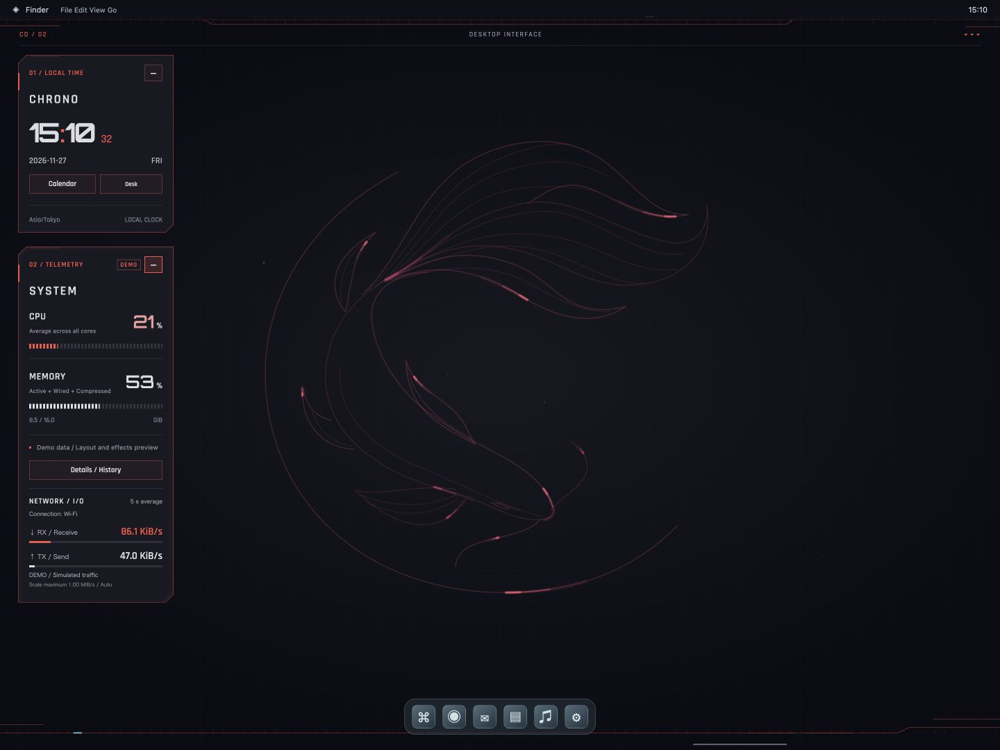
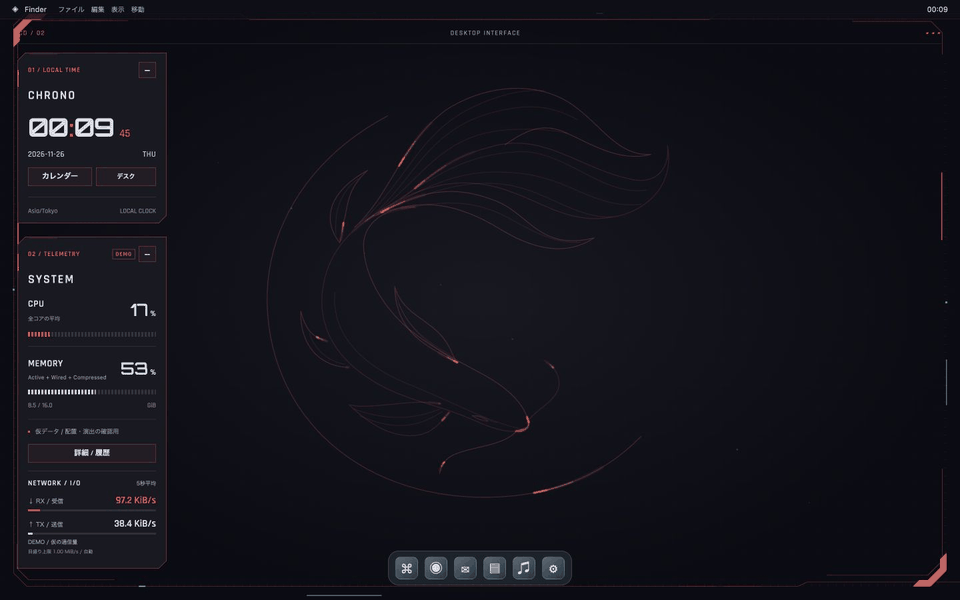
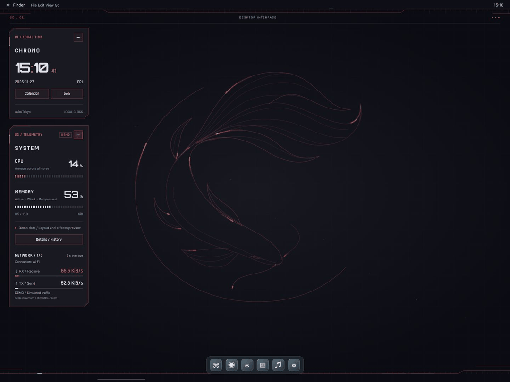
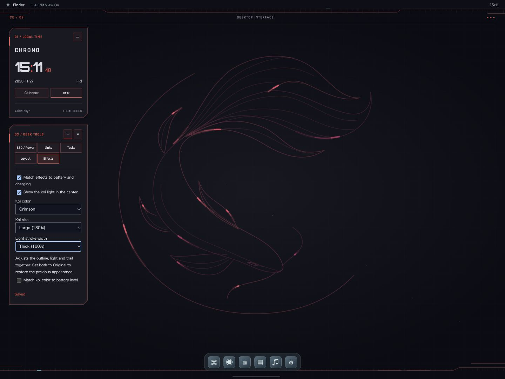

# Widget Design (original cp)

[English](README.md) | **日本語**

**暗いデスクトップに、赤いフレームと輪郭を流れる鯉の光。macOS向けの時計・システム情報・デスクツールをまとめたデザイン制作です。**

<p>
  
</p>

*実装を動かして撮影したプレビューです。CPU・メモリ・通信などは仮データで、個人のファイルやタスクは使用していません。*

管理名義は **panna-elec**。GitHubでの保存先は [widget-design-original-cp](https://github.com/panna-elec/widget-design-original-cp)、可視性は **Private** です。

[使い始める](SETUP.md) · [技術スタック](#技術スタック) · [構成](#構成) · [検証](VALIDATION.md) · [参考元・権利](RIGHTS_AND_LICENSES.md) · [アップロード前の情報確認](docs/PRIVACY_CHECK.md)

## できること

| 機能 | 内容 |
| --- | --- |
| 時計・カレンダー | 現在時刻、日付、月間カレンダー |
| システム情報 | CPU・メモリ・通信速度、接続方式の判別と方式別内訳、CPUと通信の短い履歴 |
| デスクツール | SSD空き容量、電源状態、アプリ／フォルダーへのリンク、タスク |
| 表示言語 | 元が日本語の操作・小見出し・カレンダー・説明を日英切替。CHRONO・SYSTEMなど元の英語表記は維持 |
| 配置 | パネルの折りたたみ、移動・サイズ調整、Dock位置を考慮した配置保存 |
| デザイン | REFERENCE・CYBER・CLEAN、3配色、起動・文字・走査線の演出 |
| 電源連動 | しきい値を調整できる残量色、充電時のアクセント、粒子 |
| 中央の鯉 | 6配色、光と残光、大きさ・線の太さを個別に保存 |
| 鑑賞モード | デスクトップアイコンを一時的に隠し、元の表示へ復元 |
| 上部バー | SketchyBarによる名称と電源表示（任意） |

REFERENCEは角のある枠・計器・文字演出を組み合わせたMac用デザインです。鯉はpanna-elecがOpenAIの画像生成機能で制作した図案を参考にSVG化し、光と残光を実装しています。制作時の出所と適用条件は[ASSETS.md](ASSETS.md)と[LICENSE_SCOPE.md](LICENSE_SCOPE.md)に記載しています。

**デスク / Desk → 表示言語 / Language** で **日本語** または **English** を選択します。保存に成功するとすぐに切り替わり、再読み込み後も保持します。既存データは日本語が既定で、タスク本文・リンク名・パスは変更しません。プレビューの言語設定は実機とは別にブラウザーへ保存します。外側のプレビューページ、コマンドスクリプト、任意のSketchyBarは切替対象外です。

言語対応は実機とONショートカットの起動元にも反映し、ONで運用しています。稼働中のÜbersichtエンジンへ接続し、日英切替・実機データへの保存・再読み込み後の保持を確認しました。デスクトップのWKWebView上での直接クリック検証は未実施です。[検証記録](VALIDATION.md#display-language-2026-11-27)を参照してください。

接続方式はmacOSのインターフェース種別とUSB接続構成から判別し、Wi-Fi名・端末名・アドレスは収集しません。Wi-FiテザリングはWi-Fi、USBテザリングとUSB有線LANアダプターはUSB接続と表示します。複数接続は合計し、「詳細 / 履歴」で方式別の通信速度を表示します。回線の最高速度ではなく現在の通信量です。有線・USB機器への実際の切替は未検証です。

## 画面と動き

### 鯉の光とデスクトップ全体

鯉の輪郭に沿って短い光と残光が流れ、見出しや外周にも小さな演出が入ります。下は2026-11-27に英語表示・仮データで撮り直した約9秒のループです。REFERENCE／クリムゾン／大きさ115%／線幅130%で撮影しています。



### カレンダーとデスクの操作

2026-11-27の最新実装を英語表示・仮データで撮り直しました。CalendarとDesk（English選択済み）を開き、鯉の設定変更・保存後に、Wi-Fiの接続表示とDetails / Historyの方式別通信量を確認する約17秒のループです。操作待ちは一部短縮しています。



<details>
<summary>鯉の大きさ・線幅の設定画面を見る</summary>



「デスク」→「演出連動」で配色・大きさ・線幅を別々に選び、「設定を保存」で反映します。従来の100%設定にも戻せます。

</details>

GIFは説明用に解像度・フレーム数を抑えています。実際の滑らかさは[ローカルプレビュー](SETUP.md#プレビュー)で確認できます。プレビュー内のDock・メニューバーは見本であり、実機のアイコンを置き換える機能ではありません。[撮影条件と出所](docs/media/README.md)

## 技術スタック

<p>
 HTML &nbsp;
 CSS &nbsp;
 JavaScript &nbsp;
 Swift &nbsp;
 Python &nbsp;
 Node.js
</p>

アイコンは[DeviconのSVGとMITライセンス](docs/technical/stack-icons/README.md)を同梱しています。各技術の役割は以下のとおりです。

| 技術 | 担当すること | 実行場所 |
| --- | --- | --- |
| HTML / CSS | パネル、色、レスポンシブ配置、線と光のアニメーション | プレビュー／ウィジェット |
| JavaScript / ES Modules | 操作、演出、状態反映、領域判定、グラフ | ブラウザー／WebView |
| JSX / Übersicht API | ウィジェットの描画、5秒ごとの取得、コマンド実行、前景と背景の接続 | Übersicht |
| SVG | 壁紙、鯉の輪郭、メーター・履歴・光の経路、パネルを避けるマスク | WebView／壁紙 |
| Swift / Foundation / Darwin / IOKit / SystemConfiguration | CPU、メモリ、ネットワーク累積値、電源、ディスク、Dock情報の取得 | macOSのローカル実行ファイル |
| Python 3 | 状態の検証・保存・競合検知、設定反映、鑑賞モード、取得値の集約 | 標準ライブラリのみ |
| Bash / launchd | 導入・退避、任意のバーの開始と停止 | macOS |
| SketchyBar | 左上の小さな名称・電源バナー | 任意の別アプリ |
| Node.js | JavaScriptのロジックと橋渡し処理のテスト | 開発時のみ |

ÜbersichtがJSXを処理します。プレビューにnpm installやフロントエンドのビルドは不要です。日本語はシステムフォント、英字は同梱の **Rajdhani / Orbitron（SIL OFL 1.1）** を使用します。

## まずプレビューする

このフォルダで次を実行し、`http://127.0.0.1:8767/` を開きます。

```sh
python3 -m http.server 8767 --bind 127.0.0.1
```

停止は `Control+C`。プレビューのCPU・メモリ・通信・電源は仮データです。実機への導入は[SETUP.md](SETUP.md)を参照してください。プレビュー用設定と実機の設定は別々です。

## 鯉を調整する

「デスク」→「演出連動」で選び、「設定を保存」を押します。

| 項目 | 選択肢 |
| --- | --- |
| 大きさ | 従来100%／少し大きい115%／大きい130% |
| 光の線の太さ | 従来100%／少し太い130%／太い160% |
| 配色 | ダークローズ／ワインレッド／クリムゾン／くすみモーヴ／ダスティコーラル／シアン×ピンク |

大きさは鯉全体を拡大し、線の太さは輪郭・光・残光・ひれ・目を調整します。両方100%で以前の見た目になります。旧保存データに項目がない場合も100%を使います。今回の実機確認では115%・130%を選択しましたが、個人の保存状態はリポジトリに含めていません。

バッテリー使用時も通常演出が既定です。「控えめ」「オフ」、OSの「動きを減らす」では背景の光と鯉を隠します。一時停止では光をその位置で止めます。

## ファイルとウィジェットの操作

操作パネルをÜbersichtの主画面へ直接配置し、パネルの表示領域に限ってクリックを受け取ります。背景の光は独立した操作を受け取らない層です。パネル外はデスクトップの操作へ戻し、配置のドラッグ中だけ判定を広げます。

前景のiframeを廃止した修正後、ファイル選択直後のボタン操作について実機利用者から解消の確認を受けています。macOSの壁紙クリック設定は元の状態へ戻したうえでの確認です。実装は[構造の説明](docs/ARCHITECTURE.md)を参照してください。

## 構成

```text
cyberdeck.widget/       # 実機用の前景・背景、画面、設定保存
  index.jsx            # 操作パネルと実測値の橋渡し
  background.jsx       # 背景の光
  lib/                 # HTML / CSS / JS / SVG / OFLフォント
  bin/                 # Python処理（statsは導入時にビルド）
native/Stats.swift     # 実測値取得のSwift原本
sketchybar/            # 任意の上部バー
scripts/              # 導入・停止・設定反映・検証
tests/               # 自動テスト
index.html            # ブラウザープレビュー
wallpaper*.png        # 静止壁紙3案
SETUP.md              # 導入・操作・停止
VALIDATION.md         # 確認済み事項と制約
RIGHTS_AND_LICENSES.md # 参考元・同梱素材の条件
ASSETS.md             # 制作時の出所記録
asset-inventory.csv   # 同梱素材・コードのSHA-256
```

## 確認済みの実行環境（2026-11-26）

Pythonを3.13.1から **3.13.18**、開発用Node.jsを25.6.1から **26.13.1 LTS（Lithium）** へ更新し、インストール後の環境で確認しました。

| 実行環境・ツール | 更新後のバージョン | 用途 |
| --- | --- | --- |
| Python | **3.13.18** | 実測値の取得処理、状態の検証・保存、設定反映 |
| Node.js | **26.13.1 LTS** | JavaScriptのロジック・クリック判定・橋渡し処理のテスト |
| pip / npm | 26.2.2 / 11.20.0 | 各実行環境に付属するパッケージ管理ツール |

上記Node.jsは開発用です。Übersichtに内蔵されたNode.jsや画面描画用のWebViewとは別で、今回Übersicht内蔵版やSwiftは変更していません。実機スクリプトが使う従来のPython呼び出し先でも3.13.18が起動することを確認しました。

更新後の確認結果：

- Python unittest **14件成功**。状態保存・電源判定・設定反映などを確認。Finder設定を変更する操作はテスト内でモックを使用。
- JavaScript検証 **5スクリプト成功**。計測差分・通信・配置・実測値の復帰・クリック判定・メッセージ橋渡しを確認。
- 導入済みウィジェットの情報取得処理を2回実行し、CPU・メモリ・通信・電源・SSD・保存設定・デスクトップ状態を取得できることを確認。
- 実機ÜbersichtでLIVE表示と実測値の更新、カレンダー／デスクパネルの開閉、鯉の設定保持を確認。
- 保存データのSHA-256は更新前と一致。タスク・リンク・配置・鯉の設定を保持。

保存の書き込み試験は一時データで行い、個人の本番設定を変更する保存操作はしていません。長時間利用、実スリープ復帰、他のHomebrewアプリ全体の回帰試験は未実施です。その他の確認範囲は[検証と制約](VALIDATION.md)を参照してください。

## ライセンス

| 対象 | 条件 |
| --- | --- |
| 独自コード・設定・テスト・付随文書・koi.js内の鯉SVG | [GPL-3.0-or-later](LICENSE) |
| 独立した壁紙3種のSVG・PNG、READMEのJPEG・GIF | [CC BY 4.0](LICENSES/CC-BY-4.0.txt) |
| 同梱フォント | 元のOFL 1.1・著作権表示 |
| Devicon技術アイコン | 元のMIT表示。商標権は別扱い |
| Übersicht・SketchyBar | 別途導入する実行環境。各上流条件を維持し、本体は非同梱 |

独自制作物の許諾者はpanna-elec。[対象ファイル・例外・クレジット例](LICENSE_SCOPE.md)を参照してください。GPLは商用配布も認めますが、対象の派生コードへのGPL適用、対応ソースの提供、原文・著作権・変更表示等が必要です。受領者がアクセスできないPrivate URLだけではソース提供になりません。コンパイル済みstatsを配布する場合は同じ版のSwift原本・ビルド手順を提供し、導入済みフォルダーだけを配布しないでください。

CC BYは作者・出典・ライセンス・変更表示等を条件に、指定画像の商用利用・加工を認めます。元画像のAI生成記録とSHAの確認は、独占的著作権・第三者権利の非侵害保証とは別です。許諾できる権利の範囲で提供します。

## ライセンス整備時の確認（2026-11-27）

素材台帳52件のSHA、文書リンク、ライセンス原文とコピー、package.jsonのprivate:trueを確認しました。画像・フォントは変更なし。koi.jsはライセンスコメント3行のみ追加。今回の文書整備で新たな導入・実機操作試験は行っていません。[検証と制約](VALIDATION.md)を参照してください。

## 個人情報と今後の更新

ユーザーのタスク・リンク・配置は `~/Library/Application Support/Cyberdeck/` に保存されます。これらやログ、実機スクリーンショット、過去のバックアップ、ビルド済みバイナリはGitの対象にしません。

既存のマイページとCodexの「Githubデザイン」を保持するため、この保存用フォルダは独立したコピーです。GitHubへのアップロード・Publicへの変更・Pages公開は、それぞれ明示的な依頼に従います。

README.mdを英語の標準版、README.ja.mdを日本語版として同時に更新します。詳細文書は主に日本語で、第三者ライセンス原文を保持します。GitHubリポジトリはPrivateのままです。
