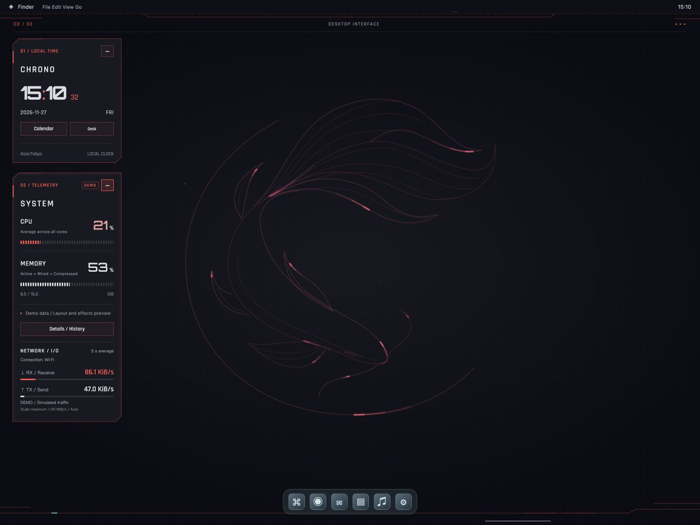
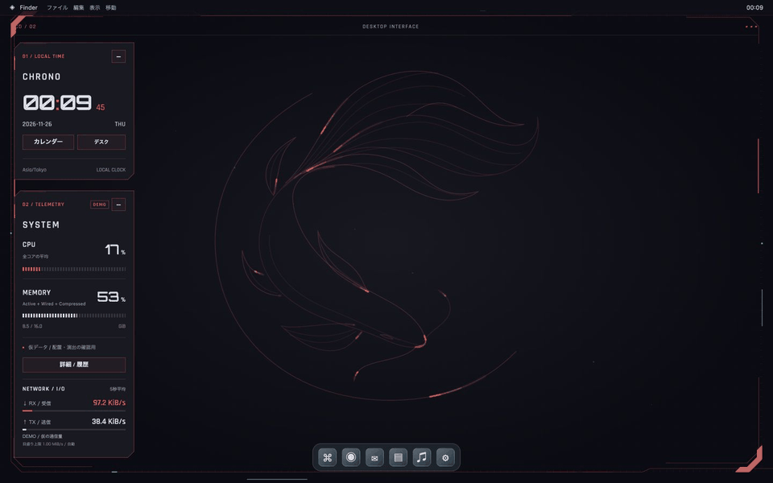
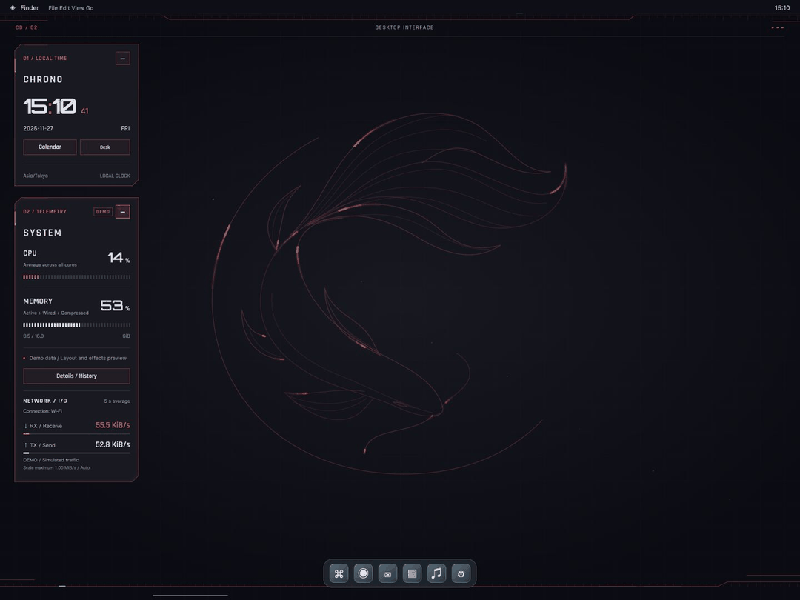
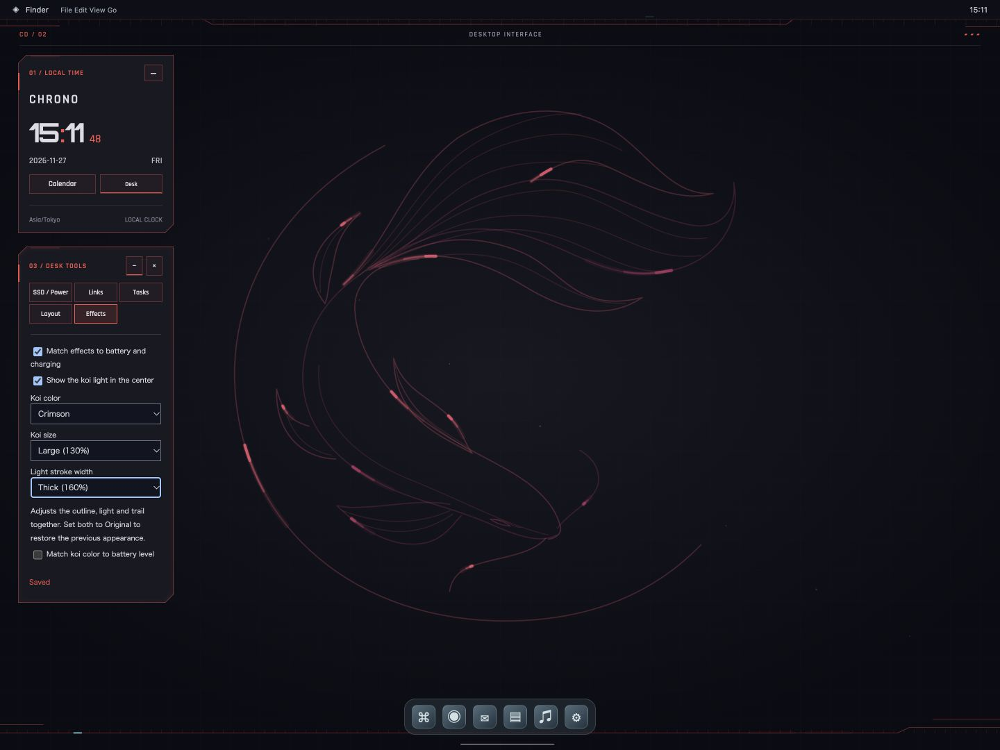

# Widget Design (original cp)

**English** | [日本語](README.ja.md)

A macOS desktop widget with angular red frames, flowing koi light trails, a clock, system meters and desk tools. Built for **Übersicht**, with a standalone browser preview.

<p></p>

*Captured from the running preview with synthetic metrics and demo content. Personal desktop files and tasks are not used.*

[Features](#features) · [Animation](#animation) · [Technology](#technology) · [Get-started guide](#get-started) · [Validation](#validation) · [Licensing](#licensing)

## Features

| Feature | Description |
| --- | --- |
| Clock and calendar | Current time, date and monthly calendar |
| System meters | CPU, memory, transfer rates, detected connection types, per-type throughput and short histories |
| Desk tools | SSD free space, power state, application/folder links and tasks |
| Display language | Japanese/English for originally Japanese controls, sublabels, calendar and help; original English headings stay unchanged |
| Layout | Collapsible, movable, resizable panels with saved placement and Dock awareness |
| Themes | REFERENCE, CYBER and CLEAN; color palettes, startup, text and scan-line effects |
| Power effects | Configurable battery thresholds, charging accents and particles |
| Koi | Six palettes, light trails, independently saved size and stroke width |
| Viewing mode | Temporarily hide desktop icons and restore their earlier visibility |
| Optional top bar | Name and battery banner through SketchyBar |

The koi SVG was drawn with reference to artwork panna-elec created using OpenAI image generation. Its source and licensing are documented in [ASSETS.md](ASSETS.md) and [LICENSE_SCOPE.md](LICENSE_SCOPE.md).

Open **Desk / デスク → 表示言語 / Language** and select **日本語** or **English**. The selection applies immediately after a successful save and is retained after reload. Existing data defaults to Japanese; task text, link names and paths stay unchanged. The browser preview saves this choice separately from the installed widget. The outer preview page, command scripts and optional SketchyBar are outside this language setting.

The language update has been installed locally and enabled. Japanese/English switching, saving and persistence after reload were verified through the running Übersicht engine; direct desktop WKWebView click testing remains unverified. See [validation details](VALIDATION.md#display-language-2026-11-27).

Network connection labels use local macOS interface types and USB ancestry, without collecting Wi-Fi/device names or addresses. Wi-Fi tethering is shown as Wi-Fi; USB tethering and USB LAN adapters share the USB label. Multiple measured connections are combined, with per-type rates under Details / History. The display measures current traffic, not maximum connection speed. USB/wired hardware switching has not yet been tested on this Mac.

## Animation

### Koi light trails

A roughly nine-second English-mode loop, re-recorded on 2026-11-27 in REFERENCE / crimson, at 115% koi size and 130% stroke width. The displayed metrics are simulated.



### Panel controls

Re-recorded on 2026-11-27 in English using the current implementation and simulated data. Open Calendar and Desk (English selected), adjust and save the koi settings, then view the Wi-Fi connection label and per-type traffic under Details / History. The roughly 17-second loop shortens pauses between actions.



<details>
<summary>Koi size and stroke settings</summary>



In English mode, open **Desk → Effects**, select options and press **Save settings**. Both controls retain the original 100% setting.

</details>

GIF resolution and frame rate are reduced for documentation. The preview Dock and menu bar are illustrations, not replacements for system icons. See [capture conditions and provenance](docs/media/README.md).

## Technology

<p>
 HTML &nbsp;
 CSS &nbsp;
 JavaScript &nbsp;
 Swift &nbsp;
 Python &nbsp;
 Node.js
</p>

| Technology | Role |
| --- | --- |
| HTML / CSS | Panels, colors, responsive placement and light animation |
| JavaScript / ES Modules | Controls, effects, state, hit testing and graphs |
| JSX / Übersicht API | Widget rendering, five-second polling, shell commands and foreground/background integration |
| SVG | Wallpaper, koi outlines, meters, light paths and panel masks |
| Swift / Foundation / Darwin / IOKit / SystemConfiguration | Local CPU, memory, network, power, disk and Dock measurements |
| Python 3 | State validation, saving, conflict detection, preferences, viewing mode and metric aggregation; standard library only |
| Bash / launchd | Installation, stopping, backups and optional bar sessions |
| SketchyBar | Optional name and power banner; installed separately |
| Node.js | Development tests, not the widget's rendering engine |

Übersicht handles JSX. The browser preview needs no npm install or frontend build. Bundled fonts are Rajdhani and Orbitron (SIL OFL 1.1); Japanese uses system fonts. Technology icons retain [Devicon attribution and MIT terms](docs/technical/stack-icons/README.md).

## Get started

### Browser preview

From the repository root:

```sh
python3 -m http.server 8767 --bind 127.0.0.1
```

Open http://127.0.0.1:8767/ and stop with `Control+C`. Metrics are synthetic, preview preferences are separate from installed settings, and the preview does not open local apps or folders.

### macOS installation

The recorded installation uses Apple Silicon, Übersicht 1.6.82 and Homebrew Python 3. Building the helper requires Xcode Command Line Tools. Scripts contain Apple Silicon Homebrew paths; Intel Macs and other layouts are untested. SketchyBar 2.24.1 is optional.

Install [Übersicht](https://tracesof.net/uebersicht/) separately, then build and install:

```sh
swiftc -O native/Stats.swift -o cyberdeck.widget/bin/stats
bash scripts/install-widget.sh
```

The installer refuses to overwrite an existing `cyberdeck.widget`. Read [SETUP.md (Japanese)](SETUP.md) for prerequisites, wallpaper alignment, installation paths, updates, restoration and optional bar controls. Downloading this repository does not automatically update a running widget.

### Koi and desktop controls

| Setting | Choices |
| --- | --- |
| Size | 100%, 115%, 130% |
| Stroke width | 100%, 130%, 160% |
| Palette | Dark rose, wine red, crimson, muted mauve, dusty coral, cyan × pink |

Choose **デスク → 演出連動 → 設定を保存**. Both 100% values restore the original appearance; older saved data defaults to them. Reduced/off effects and the OS reduced-motion setting hide ambient light and koi; pause freezes the light in place.

Interactive panels receive clicks within their visible regions. The background is noninteractive; areas outside panels allow desktop interaction. The file-selection/button issue was confirmed resolved by the user after the foreground iframe was removed. See [architecture](docs/ARCHITECTURE.md).

Viewing mode changes Finder visibility and reloads Finder; it does not move or delete files. Avoid toggling it during Finder copy operations. Stop and restore according to [SETUP.md](SETUP.md).

## Repository layout

```text
cyberdeck.widget/       Foreground/background widget and license notices
  lib/                 UI, effects, SVG artwork and OFL fonts
  bin/                 Python helpers; stats is built locally
native/Stats.swift     Source of the native metric helper
sketchybar/            Optional bar configuration
scripts/              Installation, controls and verification
tests/               Automated tests
index.html           Browser preview
wallpaper*.png       Three static wallpapers
docs/media/          Demo screenshots and animations
LICENSE_SCOPE.md     Per-file licenses and exceptions
asset-inventory.csv  Asset/code paths and SHA-256 hashes
```

## Validation

The **2026-11-26 environment-update record** lists Python **3.13.18**, development Node.js **26.13.1 LTS**, pip **26.2.2** and npm **11.20.0**. Übersicht's embedded Node.js, its WebView and Swift were not upgraded in that work.

That check recorded 14 Python tests and five JavaScript verification scripts, two metric-collection runs, LIVE updates, calendar/desk interactions and retained koi settings. Saved-state hashes were unchanged; save tests used temporary data and Finder-changing tests used mocks. Long-duration use, real sleep/resume and unrelated Homebrew applications were not tested.

The **2026-11-27 license checks** verified 52 inventory hashes, document links, license-text copies and `private: true` package metadata. Media and fonts were unchanged. The only `koi.js` change was a three-line license comment. This documentation update does not claim a new installation or native interaction test. See [VALIDATION.md](VALIDATION.md) for commands and limitations.

## Licensing

**Licenses depend on the file; independent artwork and third-party assets have separate terms.**

| Scope | License / conditions |
| --- | --- |
| Original code, settings, tests, associated original documentation and the embedded koi SVG in `koi.js` | [GPL-3.0-or-later](LICENSE) |
| Three independent wallpapers (SVG and PNG), README JPEGs and GIFs | [CC BY 4.0](LICENSES/CC-BY-4.0.txt) |
| Bundled fonts | Original SIL OFL 1.1 terms and copyright notices |
| Devicon technology icons | Original MIT notices; trademark rights remain separate |
| Übersicht / SketchyBar | Installed separately under their upstream terms; not bundled |

The licensor for original work is **panna-elec**. See [LICENSE_SCOPE.md](LICENSE_SCOPE.md) for exact paths, exceptions and attribution examples. GPL permits commercial distribution, with applicable notice, corresponding-source and copyleft requirements. A private repository URL inaccessible to recipients is not sufficient source provision. If distributing compiled `stats`, provide its matching Swift source and required build material; do not distribute only the installed widget folder.

CC BY permits commercial use and adaptation of the specified artwork with attribution, a license link and change notices. AI provenance does not guarantee exclusive copyright or absence of third-party rights; grants cover only rights panna-elec can license.

## Privacy and maintenance

Personal tasks, links and layout are stored under `~/Library/Application Support/Cyberdeck/`, outside Git. Logs, live screenshots, backups and compiled binaries are excluded. See the [privacy checklist](docs/PRIVACY_CHECK.md).

[panna-elec/widget-design-original-cp](https://github.com/panna-elec/widget-design-original-cp) is **Public**. This is a source-code repository; GitHub Pages and binary releases are not enabled. Future uploads, visibility changes, hosting and installed-widget updates follow their respective authorization scopes. Existing source workspaces and running widgets are preserved.

Maintain `README.md` in English and `README.ja.md` in Japanese together. Supporting documentation is currently mainly Japanese. [Rights review](RIGHTS_AND_LICENSES.md), [asset provenance](ASSETS.md) and [inventory](asset-inventory.csv) retain detailed records and original third-party notices.
